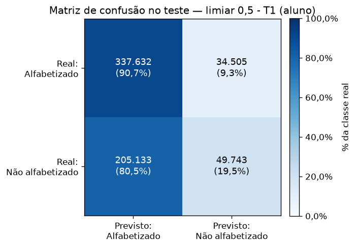
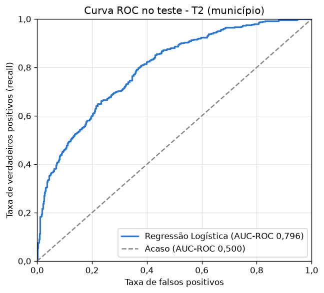
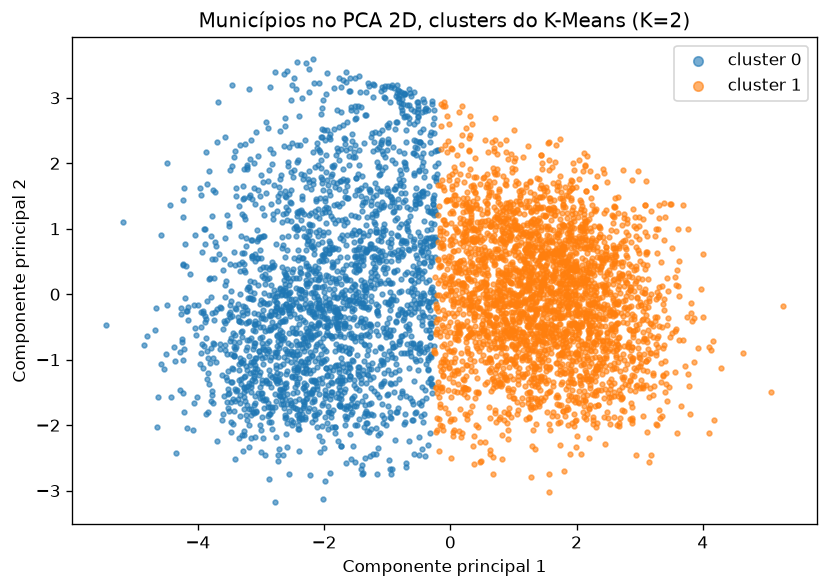

# Predição e inteligência analítica para alfabetização no Brasil

Tech Challenge da Fase 3 da pós-graduação em AI Scientist da FIAP (Pós Tech). O projeto utiliza um snapshot da camada Gold construída na Fase 2 para analisar alfabetização, treinar modelos supervisionados e apoiar a investigação de vulnerabilidades educacionais.

**Resultado principal:** o modelo de classificação do aluno, Gradient Boosting, apresentou AUC-ROC de **0,6317** no teste. O modelo complementar de município, Regressão Logística, apresentou **0,7955** para o risco de não atingir a meta de 2024. Esses resultados avaliam tarefas e populações diferentes; não devem ser comparados como se fossem o mesmo problema.

Os modelos, gráficos, interpretações e rankings estão implementados. A previsão para anos futuros permanece sem validação temporal. **O vídeo executivo de até cinco minutos ainda está pendente.**

## Sumário

- [Contexto do problema](#contexto-do-problema)
- [Objetivo analítico e trilhas](#objetivo-analítico-e-trilhas)
- [Estado da entrega](#estado-da-entrega)
- [Estrutura do repositório](#estrutura-do-repositório)
- [Como rodar](#como-rodar)
- [Descrição da base utilizada](#descrição-da-base-utilizada)
- [Etapas de modelagem](#etapas-de-modelagem)
- [Escolha dos algoritmos](#escolha-dos-algoritmos)
- [Métricas de avaliação](#métricas-de-avaliação)
- [Interpretação dos resultados](#interpretação-dos-resultados)
- [Insights e perguntas de negócio](#insights-e-perguntas-de-negócio)
- [Limitações do projeto](#limitações-do-projeto)
- [Aplicação prática para políticas públicas](#aplicação-prática-para-políticas-públicas)
- [Decisões técnicas](#decisões-técnicas)
- [Possíveis evoluções futuras](#possíveis-evoluções-futuras)
- [Documentação e evidências](#documentação-e-evidências)
- [Práticas de desenvolvimento](#práticas-de-desenvolvimento)
- [Vídeo executivo](#vídeo-executivo)

## Contexto do problema

Gestores públicos e lideranças educacionais precisam identificar vulnerabilidades, acompanhar metas e compreender padrões regionais para orientar investigações e priorizar ações. A Fase 2 organizou a engenharia de dados; esta fase utiliza sua camada Gold para produzir modelos e análises.

Os resultados representam associações e capacidade de classificação nos dados disponíveis. Não estimam o efeito causal de políticas públicas e não substituem avaliação pedagógica individual ou análise do contexto local.

## Objetivo analítico e trilhas

O objetivo principal é classificar se um aluno é alfabetizado ou não, usando variáveis educacionais, territoriais e socioeconômicas disponíveis na Gold. O modelo municipal é complementar e não substitui esse objetivo.

| Trilha | Unidade e população | Objetivo | Classe positiva |
|---|---|---|---|
| T1: aluno | Registro de avaliação de aluno com caderno preenchido, em 2023 ou 2024 | Classificar não alfabetização | `nao_alfabetizado = 1` |
| T2: município | Município da rede municipal com rótulo de meta em 2024 | Classificar o risco de não atingir a meta de 2024 | `nao_atingiu_meta = 1` |
| T3: agrupamento | Município com os seis atributos completos | Descrever perfis socioeducacionais semelhantes | Não se aplica: não há alvo |
| T4: interpretação | Modelos finais de T1 e T2 | Examinar atributos associados às previsões | A classe de risco de cada modelo |

T1 não acompanha a trajetória do mesmo aluno ao longo do tempo. Rede e caderno precisam estar disponíveis no momento de uso; o resultado da prova, a proficiência, a presença e o preenchimento não entram como atributos. O preenchimento é utilizado somente para definir a população analisada. Em T2, a meta de 2024 é considerada conhecida antes do resultado e os indicadores educacionais de entrada são de 2023.

## Estado da entrega

| Componente | Estado |
|---|---|
| Snapshot da Gold, leitor, exportador e dicionário | Implementados |
| Análise exploratória e hipóteses | Disponíveis em [02_eda.ipynb](notebooks/02_eda.ipynb) |
| Experimentos de modelagem de T2 documentados em notebook | [03_modelagem_municipios.ipynb](notebooks/03_modelagem_municipios.ipynb), executado do zero sem erros |
| Preparação, modelos, otimização e validação | Implementadas |
| Avaliação, interpretação, agrupamento e rankings | Implementados, com relatórios e figuras |
| Respostas de negócio | Sintetizadas neste README, com limites de interpretação |
| Testes automatizados | 257 testes passam em Python 3.12 (macOS ARM64), em ambiente criado do zero com o `requirements.txt` |
| Ensaio integral de reprodução em ambiente novo | Parcial: testes e notebook 03 foram executados; o retreino completo (T1 e T2) e os notebooks 01 e 02 não foram reexecutados |
| Vídeo executivo | Pendente de gravação e link |

## Estrutura do repositório

```text
data/                     snapshot da Gold em Parquet e documentação da origem
notebooks/                01 esqueleto histórico, 02 análise exploratória, 03 modelagem de T2
src/
  config.py               caminhos, semente e colunas das trilhas
  preprocessing/          leitura, qualidade, tabelas e pré-processamento
  modeling/               divisão, treinamento, otimização, agrupamento e ranking
  evaluation/             métricas, diagnóstico, avaliação final e interpretação
  visualization/          gráficos exploratórios, avaliação, agrupamento e SHAP
models/                   pipelines finais de T1 e T2 em joblib
tests/                    testes automatizados
reports/                  métricas, tabelas, rankings e documentação técnica
images/                   figuras geradas pelos scripts
requirements.txt          dependências com versões fixadas
README.md                 contexto, execução, resultados e limitações
.gitignore                exclusão de ambientes locais e credenciais
```

## Como rodar

### Ambiente e instalação

São necessários Git e Python. Há execuções verificadas com Python 3.13.13 em Windows 11 AMD64 e com Python 3.12 em macOS ARM64. As dependências estão em [requirements.txt](requirements.txt); pequenas diferenças numéricas nas árvores podem ocorrer entre ambientes. A semente não garante igualdade entre sistemas ou versões das bibliotecas.

Clone o repositório ou abra sua cópia local. Execute os comandos seguintes na raiz do projeto.

**Windows / PowerShell:** crie o ambiente virtual e instale as dependências. A chamada direta ao executável dispensa ativação e alteração da política de execução.

```powershell
py -3.13 -m venv .venv
.\.venv\Scripts\python.exe -m pip install -r requirements.txt
.\.venv\Scripts\python.exe -m pip check
```

Execute os testes com arquivos temporários fora do projeto:

```powershell
$temporarioTestes = Join-Path $env:TEMP ("teste-fase3-" + [guid]::NewGuid().ToString())
.\.venv\Scripts\python.exe -m pytest -q -p no:cacheprovider --basetemp "$temporarioTestes"
```

**macOS / Linux:** a execução em Linux não foi verificada nesta entrega. Os comandos equivalentes de ambiente e testes são:

```bash
python3.12 -m venv .venv
source .venv/bin/activate
python -m pip install -r requirements.txt
python -m pip check
python -m pytest -q -p no:cacheprovider --basetemp "$(mktemp -d)"
```

### Gerar análises com os modelos publicados

O snapshot e os modelos já estão versionados. Não é necessário acesso ao GCP para executar as análises locais. Os comandos abaixo sobrescrevem os relatórios e figuras correspondentes; o ranking refaz ajustes por dobra sem substituir os modelos finais salvos.

No PowerShell:

```powershell
.\.venv\Scripts\python.exe -m src.evaluation.avaliacao_final
.\.venv\Scripts\python.exe -m src.evaluation.interpretacao_modelos
.\.venv\Scripts\python.exe -m src.modeling.agrupamento_municipios
.\.venv\Scripts\python.exe -m src.modeling.ranking_municipios
```

No macOS/Linux, com o ambiente ativado, use `python` no lugar de `.\.venv\Scripts\python.exe`. A avaliação confere AUC-ROC, AUC-PR e matriz de confusão contra os relatórios antes de desenhar. Se o modelo salvo não reproduzir as métricas, regenere o treinamento correspondente antes das análises.

### Reproduzir o treinamento

Os comandos abaixo treinam e sobrescrevem o modelo e o relatório de cada trilha. O custo computacional é maior em T1; o tempo depende do computador. Execute em uma cópia de trabalho e confira as diferenças dos artefatos antes de versioná-las.

```powershell
.\.venv\Scripts\python.exe -m src.modeling.treino_municipio
.\.venv\Scripts\python.exe -m src.modeling.treino_aluno
```

Após o treinamento, execute novamente avaliação, interpretação e ranking para manter seus artefatos alinhados. O agrupamento usa o snapshot e não depende dos modelos supervisionados.

Para regenerar o dicionário, use `python -m src.preprocessing.qualidade` com o Python do ambiente. Abra [02_eda.ipynb](notebooks/02_eda.ipynb) no editor Jupyter, selecione o ambiente virtual e execute as células em ordem. A primeira célula pressupõe o diretório de trabalho `notebooks/`; ajuste o diretório do kernel se o editor iniciar na raiz. O notebook [03_modelagem_municipios.ipynb](notebooks/03_modelagem_municipios.ipynb) segue o mesmo procedimento e reproduz, com os módulos do projeto, a modelagem de T2 (tabela, divisão por município, validação cruzada agrupada, comparação de modelos, avaliação em validação e teste e permutação). Ele foi executado do zero em Python 3.12, sem erros, e duas execuções seguidas deram resultados idênticos. Os notebooks 01 e 02 não foram reexecutados nesta atualização.

Os notebooks usam `python3` como kernel e importam `src`, então devem ser abertos com a raiz do projeto como diretório de trabalho (o 02 pressupõe `notebooks/`). Para executar o 03 fora do editor, é preciso instalar `nbclient` com `nbformat` (já presentes no `requirements.txt`) e um kernel `python3` do ambiente virtual.

### Atualizar o snapshot da Gold

A leitura cotidiana é local. Recriar a Gold ou exportá-la do BigQuery é uma operação separada que exige o ambiente da Fase 2, credenciais autorizadas e verificação de custos. Veja [data/README.md](data/README.md). Não é necessário recriar infraestrutura cloud para esta execução.

## Descrição da base utilizada

A fonte é o dataset Gold `alfabetizacao_analytics`, construído na Fase 2 sobre `basedosdados.br_inep_avaliacao_alfabetizacao`. O snapshot foi extraído em **07/10/2026**, em Parquet, com aproximadamente 30 MiB. O pipeline batch foi utilizado sem os eventos sintéticos de streaming.

| Tabela | Unidade | Linhas |
|---|---|---|
| `fact_alunos` | Registro de avaliação de aluno | 3.867.999 |
| `fact_meta_resultado_municipio` | Município, rede e ano, com controle de versão | 10.698 |
| `fact_indicador_municipio` | Ano, município, série e rede | 23.995 |
| `fact_alfabetizacao_municipio` | Ano, município, rede e série | 23.995 |
| `dim_municipio` | Município | 5.571 |
| `dim_rede`, `dim_serie`, `dim_tempo`, `dim_uf` | Dimensões | 5, 1, 8 e 27 |

- Os fatos têm dados de **2023 e 2024**. Anos futuros na dimensão de tempo não representam observações reais.
- Entre os registros com proficiência, `alfabetizado` corresponde ao corte de **743 pontos**. T1 usa **3.354.661 registros** de 5.547 municípios com caderno preenchido.
- Os **513.338 cadernos em branco** ficam fora de T1: o rótulo falso por ausência não deve ser confundido com resultado de alfabetização.
- T2 usa **5.226 municípios** com rótulo em 2024: 2.782 atingiram a meta e 2.444 não. AC, DF e RR não estão representados nesse conjunto.
- Os atributos usados incluem UF, região, capital e IDHM e componentes. T1 também usa rede e caderno; T2 inclui taxa e média de Português de 2023, meta de 2024 e folga.
- Não foi acrescentado enriquecimento externo nesta fase. As análises usam metas municipais; não há análise própria de metas nacionais/estaduais nem atributo populacional nos modelos atuais.
- Ausências e colunas sem informação estão registradas no [dicionário](reports/dicionario_dados.md). As listas definitivas de atributos permitidos e proibidos estão em [src/config.py](src/config.py).

O snapshot preserva a versão usada e permite execução sem credenciais; não acompanha atualizações da Gold automaticamente. O identificador individual `id_aluno` foi removido da exportação. Detalhes de origem e transformações: [documentação dos dados](data/README.md).

## Etapas de modelagem

1. Construção das tabelas T1 e T2, com atributos, alvo e município alinhados. Joins validam a cardinalidade e colunas de resultado são excluídas dos atributos.
2. Separação de municípios em treino, validação e teste, nas proporções **60/20/20**, com estratificação por região. Todos os registros de um município ficam no mesmo conjunto.
3. Pré-processamento integrado ao estimador: mediana para ausências numéricas, `StandardScaler` na Regressão Logística e One-Hot nas categóricas, aceitando categorias desconhecidas.
4. Baselines Dummy e Regressão Logística padrão; comparação com Regressão Logística ajustada, Random Forest e Gradient Boosting.
5. Busca de hiperparâmetros e validação cruzada agrupada por município, com **cinco dobras somente no treino**. Imputação, escala e encoding são ajustados dentro do pipeline de cada dobra.
6. Escolha pela maior AUC-ROC média de validação cruzada entre os candidatos. O teste não é usado pela rotina de seleção.
7. Avaliação de validação com o modelo ajustado somente no treino; reajuste em treino + validação e avaliação final no teste.

Em T1, o treino completo tem 1.971.880 registros e a validação 755.768. Para limitar o custo, usam-se amostras de **100.000** e **50.000**, sorteadas após separar municípios. O reajuste final usa essas amostras reunidas (**150.000 registros**), enquanto o teste usa todos os **627.013 registros** reservados. Em T2 não há amostragem: treino de 3.135 municípios, validação de 1.045 e teste de 1.046.

O diagnóstico adotado sinaliza overfitting quando a razão de erros `(1 − AUC de avaliação) / (1 − AUC de treino)` é pelo menos 2. Ele é um critério do projeto, não uma garantia universal de ausência de overfitting. Detalhes: [pré-processamento](reports/readme-escalonamento.md), [treino T1](reports/readme-treino-t1.md) e [treino T2](reports/readme-treino-t2.md).

### Notebook de modelagem de T2

[03_modelagem_municipios.ipynb](notebooks/03_modelagem_municipios.ipynb) documenta, passo a passo e com saídas, a modelagem do risco de não atingir a meta de 2024. É uma reprodução didática e simplificada, feita com os módulos de `src/`: usa a Regressão Logística padrão do protocolo, enquanto os números oficiais deste README vêm de [treino_t2.json](reports/treino_t2.json), com `C=10`. Por isso as diferenças são pequenas e esperadas.

| Etapa | Resultado no notebook |
|---|---|
| Validação cruzada (5 dobras agrupadas por município, só no treino) | Dummy 0,500; Regressão Logística 0,780 (desvio 0,015, treino 0,790); Random Forest padrão 0,755 (treino 1,000); Random Forest regularizada 0,769 (treino 0,837) |
| Validação | AUC-ROC 0,7519; precisão 0,6751; recall 0,6571; F1 0,6660 |
| Teste (modelo reajustado em treino + validação) | AUC-ROC 0,7964; AUC-PR 0,7681; precisão 0,6897; recall 0,6695; F1 0,6794 |
| Permutação na validação (10 repetições) | UF 0,1697; meta 2024 0,0863; média de Português 2023 0,0835; taxa 2023 0,0441; região 0,0333 |

O Random Forest padrão com AUC-ROC de treino igual a 1,000 e validação menor ilustra o sobreajuste que o diagnóstico procura detectar. A permutação do notebook usa a validação e o relatório oficial de interpretação usa o teste, então os valores diferem; a ordem geral (UF à frente, seguida de atributos de meta e resultados anteriores) é coerente. Tanto o notebook quanto o relatório são descritivos e indicam associação, não causa.

O [baseline provisório](reports/baseline_provisorio.json) e o notebook de esqueleto são registros históricos. Usam população e divisão diferentes e não representam os resultados finais apresentados abaixo.

## Escolha dos algoritmos

| Trilha | Modelo escolhido | Configuração | AUC-ROC média CV | Desvio entre dobras |
|---|---|---|---|---|
| T1 | Gradient Boosting | 100 árvores, profundidade 3, taxa de aprendizagem 0,1 | 0,6278 | 0,0111 |
| T2 | Regressão Logística | `C=10`, `max_iter=1000`, atributos numéricos padronizados | 0,7800 | 0,0149 |

Em T1, as diferenças entre candidatos foram pequenas diante da variação entre dobras; não demonstram superioridade conclusiva. O Gradient Boosting foi mantido pela regra definida. Em T2, a Regressão Logística teve a maior média entre candidatos e não foi sinalizada pelo diagnóstico de overfitting. O Dummy teve AUC-ROC de 0,5 em ambas as trilhas.

A busca é em grade para a Regressão Logística e para a Random Forest de T2 (24 combinações). T1 usa busca aleatória nas árvores para limitar o custo; o Gradient Boosting de T2 também usa busca aleatória. Configurações e comparações completas: [T1](reports/comparacao_modelos_t1.csv) e [T2](reports/comparacao_modelos_t2.csv).

## Métricas de avaliação

A métrica principal é AUC-ROC. AUC-PR, precisão, recall, F1 e matriz de confusão complementam a análise. Precisão, recall e F1 abaixo usam a classe positiva de risco e **limiar 0,5**. AUC-ROC e AUC-PR não dependem desse limiar.

| Métrica | T1: validação | T1: teste | T2: validação | T2: teste |
|---|---|---|---|---|
| AUC-ROC | 0,6184 | **0,6317** | 0,7517 | **0,7955** |
| AUC-PR | 0,5234 | 0,5247 | 0,7300 | 0,7671 |
| Precisão | 0,5846 | 0,5904 | 0,6751 | 0,6898 |
| Recall | 0,2872 | **0,1952** | 0,6571 | **0,6653** |
| F1 | 0,3851 | 0,2934 | 0,6660 | 0,6773 |

Validação e teste usam conjuntos diferentes e ajustes diferentes do modelo: a validação é medida antes do reajuste final. A diferença de recall não pode ser atribuída somente à troca do conjunto.




No limiar atual, T1 identifica **19,52%** dos registros de alunos não alfabetizados no teste e deixa de apontar aproximadamente 80,48%. Portanto, seu uso como triagem individual não foi demonstrado. T2 identifica **66,53%** dos municípios que não atingiram a meta no teste. Falsos negativos podem deixar necessidades sem sinalização; falsos positivos podem direcionar recursos para casos menos prioritários. A decisão de intervenção exige considerar ambos os erros e a capacidade de atendimento.

Fontes: [treino_t1.json](reports/treino_t1.json), [treino_t2.json](reports/treino_t2.json) e [avaliação final](reports/readme-avaliacao.md).

## Interpretação dos resultados

A importância nativa apresenta coeficientes com sinal na Regressão Logística e importância sem direção nas árvores. A permutação mede a queda da AUC-ROC ao embaralhar um atributo original. O SHAP descreve contribuições por previsão; as colunas One-Hot são somadas por atributo antes do cálculo da média absoluta.

| Evidência | T1 | T2 |
|---|---|---|
| Maior queda de AUC-ROC por permutação | UF: 0,1102; região: 0,0093 | UF: 0,1948; IDHM: 0,1334; meta: 0,1112 |
| Maior SHAP médio absoluto | UF: 0,3013 | IDHM: 1,3494; UF: 0,9410 |

Nos modelos finais, SHAP está em log-odds; para Random Forest a implementação usa a escala de probabilidade. As importâncias não são contribuições causais nem parcelas que possam ser somadas para afirmar quanto uma política explica. O resumo SHAP não é um ranking direto de risco dos estados.

Em T2, `folga_2023 = taxa_alfabetizacao_2023 − meta_indicador_2024`. Alterar taxa ou meta exige atualizar a folga; interpretar um coeficiente isolado pode inverter a conclusão. IDHM e componentes também são correlacionados. A permutação pode criar combinações pouco realistas, por isso as técnicas precisam ser lidas em conjunto.

A interpretação usa amostras de teste dos modelos já escolhidos: 20 mil registros para permutação e 2 mil para SHAP em T1; os 1.046 municípios de T2 entram inteiros. Esses resultados são descritivos e não voltam à seleção dos modelos. Veja [interpretação completa](reports/readme-interpretacao.md).

## Insights e perguntas de negócio

| Pergunta do desafio | Resposta sustentada pelos resultados | Evidência e limite |
|---|---|---|
| Quais fatores mais impactam a alfabetização? | UF tem forte associação preditiva em T1; região e atributos socioeconômicos complementam a descrição. Em T2, UF, IDHM, meta e resultados anteriores se destacam | [Interpretação](reports/readme-interpretacao.md). “Impacto” é tratado como associação, sem efeito causal estimado |
| Quais municípios apresentam maior risco educacional? | Há um ranking da taxa observada de não alfabetização e, separadamente, um ranking do excesso sobre o perfil previsto | [Taxa observada](reports/ranking_taxa_nao_alfabetizados_municipios.csv) e [excesso](reports/ranking_abaixo_do_perfil_municipios.csv). São medidas diferentes, agregadas de 2023 e 2024 |
| Quais regiões possuem padrões semelhantes? | No recorte K=2, Norte e Nordeste têm maior participação no grupo de menor IDHM médio; Sul, Sudeste e Centro-Oeste têm maior participação no outro grupo | [Agrupamento](reports/readme-agrupamento.md). Os grupos são recortes descritivos de um contínuo |
| Como prever municípios que podem não atingir metas futuras? | T2 demonstra uma abordagem para a meta de 2024 com atributos de 2023 e a meta conhecida. Para avaliar anos futuros são necessários novos períodos rotulados e validação temporal | [Ranking de meta](reports/ranking_risco_meta_municipios.csv). A previsão futura permanece sem validação |
| Quais variáveis têm maior influência nos modelos? | T1: UF é a principal nas duas técnicas. T2: UF lidera a permutação, enquanto IDHM lidera o SHAP | [Tabelas e gráficos](reports/readme-interpretacao.md). A ordem depende da técnica e da trilha |

### Padrões municipais e regionais

O agrupamento considera seis atributos completos: IDHM e seus três componentes e taxas de alfabetização de 2023 e 2024. Dos 5.352 municípios do perfil, **5.222** foram agrupados e **130** foram excluídos por ausência de atributos. UF, região e capital descrevem os grupos, mas não entram na distância.

Após padronização, quatro componentes PCA explicam **97,9%** da variância. O maior silhouette na varredura de K=2 a K=10 escolheu **K=2**, com silhouette **0,4177**. O grupo 0 contém 2.246 municípios e IDHM médio 0,589; o grupo 1 contém 2.976 e IDHM médio 0,712. Dos municípios incluídos de cada região, 92,7% do Nordeste e 78,6% do Norte estão no grupo 0; 95,1% do Sul, 85,2% do Sudeste e 89,8% do Centro-Oeste estão no grupo 1.



K=3 é uma leitura complementar escolhida após observar os resultados, com silhouette menor, de 0,3642. Não substitui a atribuição oficial K=2. Ward e DBSCAN servem como comparações; os 447 outliers do DBSCAN não são automaticamente anomalias educacionais. Detalhes: [relatório de agrupamento](reports/readme-agrupamento.md).

### Três rankings diferentes

| Arquivo | Conteúdo | Cobertura |
|---|---|---|
| [Risco de meta](reports/ranking_risco_meta_municipios.csv) | Probabilidade estimada de não atingir a meta de 2024, com posições geral e dentro da UF | 5.226 municípios |
| [Taxa observada](reports/ranking_taxa_nao_alfabetizados_municipios.csv) | Taxa real de registros não alfabetizados, da maior para a menor | 5.134 municípios, com pelo menos 50 registros |
| [Abaixo do perfil](reports/ranking_abaixo_do_perfil_municipios.csv) | Taxa observada menos taxa esperada pelo modelo | Mesma população de 5.134 municípios |

As probabilidades do ranking são calculadas fora da dobra: cada município é previsto por um modelo ajustado sem seus registros, mantendo o algoritmo e os hiperparâmetros já escolhidos. Essa estratégia não equivale a uma nova avaliação independente de todo o processo de seleção. T1 agrega os dois anos e apresenta mediana de 236 registros entre os municípios incluídos; não é uma contagem de alunos únicos acompanhados entre anos.

Macururé (BA) lidera a taxa observada, com **91,57%**; Filadélfia (TO) lidera o excesso sobre o perfil, com **38,06 pontos percentuais**. Um ranking de excesso não pode substituir a comparação por necessidade absoluta. A posição dentro da UF não foi demonstrada como mais confiável para anos futuros. Veja [metodologia e limites dos rankings](reports/readme-ranking.md).

### Das hipóteses exploratórias aos resultados

| Hipótese da EDA | Leitura após os modelos e análises |
|---|---|
| H1: região e IDHM se associam à alfabetização | A descrição regional existe; no modelo T1, UF tem maior importância que os demais atributos |
| H2: o risco se concentra no Norte e Nordeste | Não se confirma como regra geral para todas as medidas: taxa observada, excesso e risco de meta respondem a perguntas distintas |
| H3: há perfis municipais semelhantes e redundância no IDHM | PCA e agrupamento resumem padrões; os municípios formam um contínuo, sem tipologia natural comprovada |
| H4: T2 teria baixo poder preditivo | A baixa discriminação univariada não impediu AUC-ROC 0,7955 no teste; o sinal territorial é relevante e a previsão temporal continua sem validação |
| H5: atributos correlacionados dividem a importância | As leituras por permutação, coeficientes e SHAP exigem cautela, especialmente para IDHM/componentes e taxa/meta/folga |

Essas são interpretações das evidências disponíveis, não novos testes causais ou confirmações estatísticas formais das hipóteses. A [EDA](notebooks/02_eda.ipynb) preserva a investigação inicial.

## Limitações do projeto

- **Generalização temporal:** os fatos abrangem dois anos e somente 2024 tem rótulo municipal de meta. Os resultados não comprovam previsão de outro ano.
- **Diferenciação individual:** registros com os mesmos valores de todos os atributos recebem a mesma probabilidade. T1 tem atributos principalmente territoriais, além de rede e caderno, e recall baixo no limiar atual.
- **Exploração anterior à divisão:** o notebook de EDA examina o alvo na base completa antes da separação. As proteções de leakage do pipeline não tornam essa exploração historicamente independente do teste; as métricas devem ser lidas com essa ressalva. Não é correto declarar que o teste nunca foi consultado no projeto inteiro.
- **Validação cruzada após busca:** as médias de CV dos candidatos reutilizam o conjunto de treino da busca; não constituem validação aninhada. O teste separado é a avaliação final do modelo escolhido pela rotina.
- **Amostragem de T1:** o modelo final usa 150 mil registros, não todo o treino e validação disponíveis. A equivalência com volumes maiores não foi estabelecida por um experimento automatizado do projeto.
- **Cobertura e ponderação:** municípios sem rótulo ou atributos podem ficar fora de determinadas análises. As taxas agregadas de T1 são médias simples de registros, sem ponderação por `peso_aluno`; não devem ser apresentadas como estimativas populacionais ponderadas.
- **Instabilidade de pequenas contagens:** o corte de 50 registros não elimina a incerteza municipal. Ausência no ranking não significa baixo risco.
- **Estado e correlação:** a divisão é por município, não necessariamente por UF. Municípios da mesma UF podem aparecer no treino e no teste. A análise agrupada por UF de T2 tem AUC média aproximadamente 0,587 e avalia transferência entre estados, não entre anos.
- **Probabilidades e limiar:** o projeto não demonstrou calibração das probabilidades nem selecionou limiar por custo de intervenção. O valor 0,5 é uma decisão técnica de referência.
- **Reprodução:** dependências fixadas e sementes ajudam, mas não garantem igualdade numérica entre plataformas. Os modelos joblib dependem da compatibilidade do ambiente; carregue somente os arquivos publicados pelo projeto ou de outra origem confiável.

## Aplicação prática para políticas públicas

Os resultados podem apoiar a organização de diagnósticos municipais e a escolha de locais para investigação aprofundada. Uma secretaria pode consultar a taxa observada e a quantidade de registros, comparar municípios de perfil semelhante e verificar se o risco de meta conta uma história diferente. O excesso sobre o perfil é um sinal para examinar dados e contexto, não prova de falha de gestão.

A priorização precisa combinar os resultados com população atendida, capacidade de intervenção e avaliação de profissionais da educação. Como o modelo não estima efeitos de ações, ele não permite afirmar qual política produzirá melhoria. A sinalização de alunos individualmente exige dados e validações adicionais, especialmente diante do recall atual de T1.

## Decisões técnicas

| Item | Requisito ou decisão |
|---|---|
| Imputação numérica, transformações, encoding e integração ao modelo | Requisitos do desafio; mediana, One-Hot e as classes utilizadas são escolhas técnicas |
| Scikit-learn | Biblioteca recomendada no enunciado e adotada no projeto |
| `Pipeline`, `ColumnTransformer`, `GroupKFold` e `DummyClassifier` | Escolhas de implementação; o PDF não exige individualmente essas classes |
| Interpretação | Exigida; Feature Importance e SHAP são técnicas recomendadas e foram implementadas nos relatórios; o notebook 03 mostra a permutação de T2 |
| Agrupamento | Escolha para responder sobre padrões semelhantes; clustering não é obrigatório no PDF |
| Semente 42 e classe positiva de risco | Convenções do projeto |
| Snapshot Parquet e modelos joblib | Permitem execução local sem consultar a cloud nem repetir todo treinamento |
| Seleção de atributos | Não há etapa automática de seleção; atributos permitidos são definidos por trilha |
| Execução em modeling/evaluation | Alguns módulos coordenam dados, cálculo e figuras; a reorganização das camadas é melhoria posterior documentada |

A execução local não provisiona recursos cloud. Não foram medidos custos monetários de energia ou hardware. O principal custo operacional local é o tempo de treinamento e a memória, especialmente em T1 e no ranking. O enriquecimento externo, Docker, API e deploy não são necessários para executar esta entrega.

## Possíveis evoluções futuras

- Obter novos anos com rótulos para validação temporal de metas.
- Acrescentar atributos individuais ou escolares disponíveis antes do resultado, com governança adequada.
- Avaliar erros por grupos, calibração e limiares com treino/validação, conforme a decisão de negócio.
- Automatizar a comparação de volumes de treinamento e examinar ponderação amostral.
- Reservar a avaliação antes de análises orientadas pelo alvo em futuros experimentos.
- Simplificar atributos correlacionados e reorganizar módulos de orquestração sem alterar resultados publicados inadvertidamente.

## Documentação e evidências

| Documento | Conteúdo |
|---|---|
| [Origem do snapshot](data/README.md) | Fonte, extração, período, tabelas e regeneração |
| [Dicionário](reports/dicionario_dados.md) | Tipos, ausências e papéis provisórios; listas definitivas em `src/config.py` |
| [Pré-processamento](reports/readme-escalonamento.md) | Imputação, escala e codificação; afirmações históricas sobre exigência de classes devem ser lidas conforme as decisões técnicas deste README |
| [T1](reports/readme-treino-t1.md) e [T2](reports/readme-treino-t2.md) | Protocolo, amostragem, parâmetros e métricas |
| [Avaliação](reports/readme-avaliacao.md) | Matrizes, curvas ROC e distribuição das probabilidades |
| [Interpretação](reports/readme-interpretacao.md) | Importância nativa, permutação e SHAP |
| [Agrupamento](reports/readme-agrupamento.md) | PCA, escolha de K, perfis e leitura exploratória K=3 |
| [Ranking](reports/readme-ranking.md) | Meta, taxa observada, excesso e cobertura |
| [Notebook 02](notebooks/02_eda.ipynb) | Análise exploratória e hipóteses |
| [Notebook 03](notebooks/03_modelagem_municipios.ipynb) | Modelagem de T2 executável, com validação cruzada, comparação, teste e permutação |

Os relatórios detalhados preservam informações de cada experimento. Este README reúne a visão da entrega; eventuais contagens e métricas devem ser conferidas nos JSONs e CSVs correspondentes.

## Práticas de desenvolvimento

O repositório registra evolução com commits, branches e pull requests. Há testes para joins, colunas proibidas, transformações ajustadas no treino, separação por município, isolamento do teste na seleção, persistência de modelos, métricas, interpretação e rankings. Alguns commits históricos de testes antecedem a implementação e falham isoladamente; a avaliação deve considerar o topo das branches integradas.

Ambientes virtuais e credenciais ficam fora do Git. A execução do snapshot dispensa autenticação; a exportação opcional usa credenciais autorizadas e não inclui chaves no código. Não use atributos, limiares ou algoritmos novos com base em sucessivas consultas ao teste final.

## Vídeo executivo

**Pendente de gravação e publicação do link.** A entrega ainda precisa do vídeo de até cinco minutos. O roteiro deve apresentar o problema educacional, os principais insights, o valor estratégico, o apoio possível às políticas públicas e os limites dos modelos, em linguagem para gestores. Nenhum link de vídeo está disponível neste repositório neste momento.
