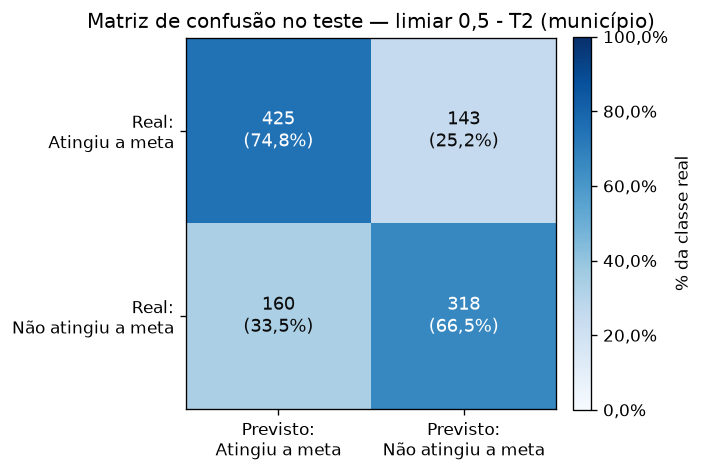
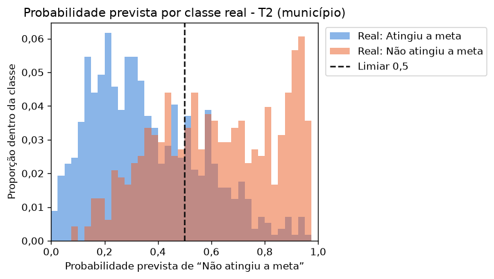
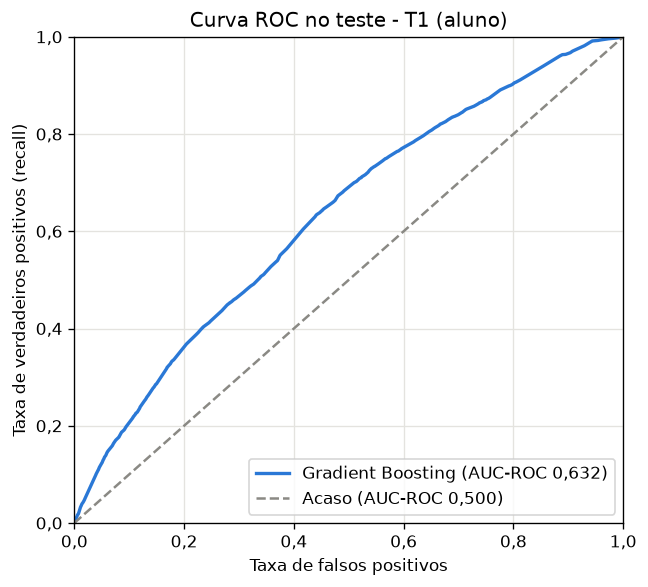
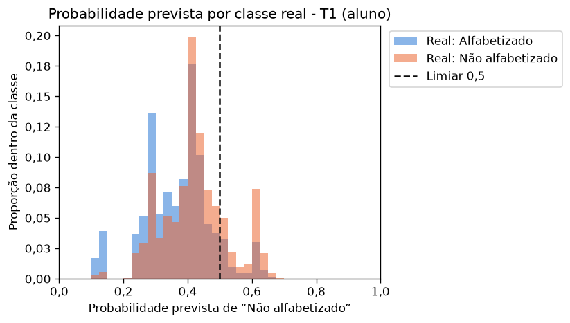

# Avaliação final: matriz de confusão, curva ROC e probabilidades

Fragmento do README, a consolidar na unidade de documentação. Gerado por `python -m src.evaluation.avaliacao_final` (cerca de 1 minuto) a partir dos modelos em `models/`.

## Como é feito

Os scripts de treino gravam o modelo final de cada trilha em `models/modelo_t1.joblib` e `models/modelo_t2.joblib` (150 KB e 7 KB, versionados para que ninguém precise retreinar). A avaliação carrega o modelo, reconstrói o conjunto de teste pela mesma semente da separação e, **antes de desenhar, confere que a AUC-ROC, a AUC-PR e a matriz de confusão batem com `reports/treino_<trilha>.json`**. Se não baterem, o modelo gravado não é o do relatório, e o script falha pedindo para rodar o treino de novo. Nada é reajustado e nenhum limiar é escolhido aqui: o teste já foi aberto pelo treino.

Na reprodução relatada pelo revisor, o modelo escolhido, as métricas de validação e teste e as matrizes de confusão coincidiram com os resultados publicados. Algumas métricas de validação cruzada das árvores apresentaram diferenças na quarta casa decimal entre ambientes. A semente não garante arquivos ou resultados numericamente idênticos em todos os sistemas.

A persistência dos modelos com joblib é uma decisão técnica do projeto: permite gerar a avaliação sem repetir o treinamento. O ambiente de referência usa joblib 1.6.0 e scikit-learn 1.9.1, conforme requirements.txt. A compatibilidade dos modelos salvos com outras versões não foi validada.

## T2 (município): não atingiu a meta

- O modelo acerta 66,5% dos municípios que não atingiram a meta (recall) e 74,8% dos que atingiram.
- As probabilidades das duas classes se separam: a maioria dos que atingiram fica abaixo de 0,4, e muitos dos que não atingiram ficam acima de 0,8. A faixa entre 0,4 e 0,6 apresenta maior taxa de erro, mas também existem erros fora dela.
- A AUC-ROC de 0,796 vem em boa parte do efeito de estado; a ressalva está em [readme-treino-t2.md](readme-treino-t2.md).

## T1 (aluno): não alfabetizado

- **O recall é de só 19,5%:** o modelo deixa de apontar 80,5% dos alunos não alfabetizados no limiar de 0,5.
- A distribuição das probabilidades explica por quê: quase todas ficam entre 0,2 e 0,6, concentradas abaixo de 0,5, e as duas classes se sobrepõem. Como os atributos são do município, da rede e do caderno, alunos com os mesmos valores de todos os atributos de entrada recebem a mesma probabilidade; o modelo separa territórios mais e menos vulneráveis, não alunos.
- A curva ROC (AUC-ROC de 0,632) mostra que um limiar mais baixo aumentaria o recall à custa de mais falsos positivos. Escolher esse limiar depende do custo de cada erro para a política pública, e as aulas não ensinam como fazê-lo, então o projeto mantém 0,5.

## Organização da execução

`src/evaluation/avaliacao_final.py` reúne a conferência das métricas e a execução que carrega dados, modelos e gera figuras. Essa organização mantém dependências entre os pacotes de avaliação e modelagem. A separação da execução em um módulo de orquestração fica como melhoria posterior; o comando atual é preservado para manter a compatibilidade com as etapas dependentes.
