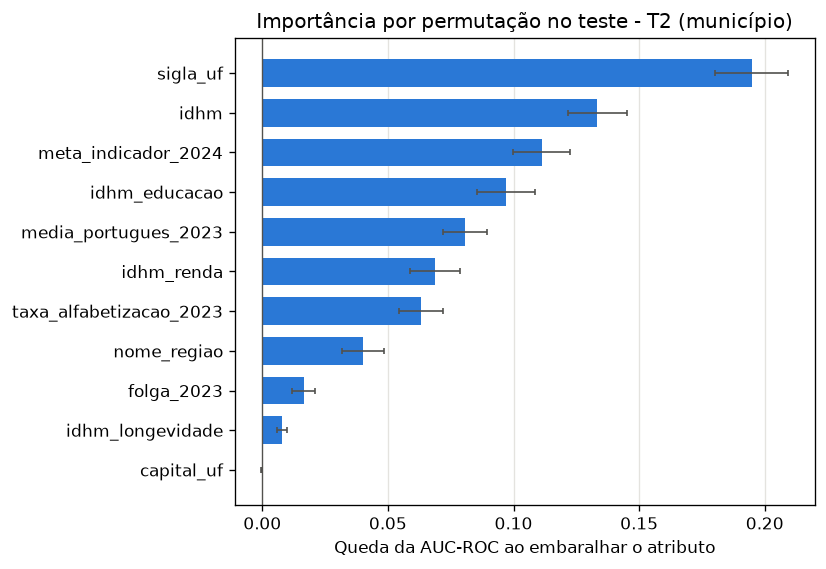
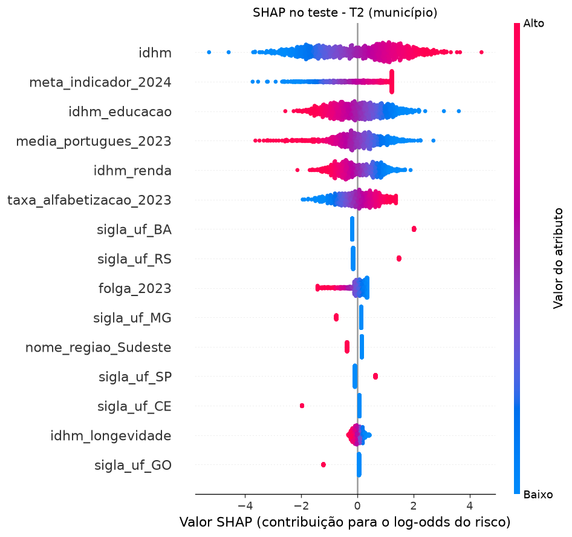
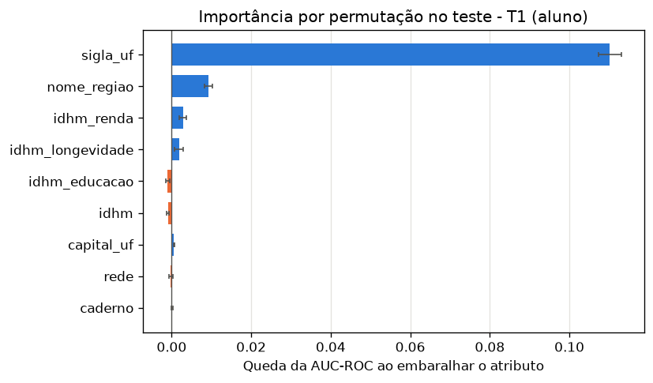
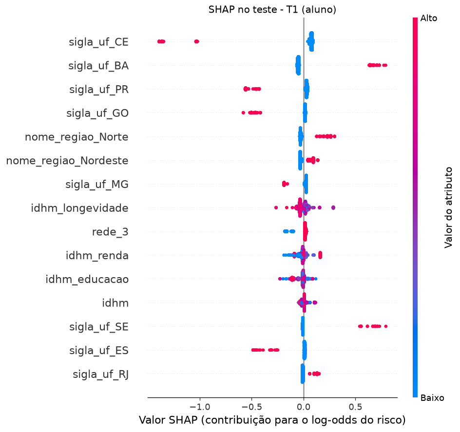

# Interpretação dos modelos (trilha T4): Feature Importance e SHAP

Fragmento do README, a consolidar na unidade de documentação. Gerado por `python -m src.evaluation.interpretacao_modelos` (menos de 1 minuto) a partir dos modelos em `models/`. Tabelas em `reports/interpretacao_{nativa,permutacao,shap}_{t1,t2}.csv` e gráficos em `images/interpretacao_*`.

## Como é feito

Três leituras do mesmo modelo, todas sobre o **conjunto de teste** (dados que o modelo não viu; a importância medida no treino premiaria o que ele decorou):

| Leitura | O que mede | Onde fica |
|---|---|---|
| Importância nativa | Coeficiente da Regressão Logística (com sinal, na escala padronizada) ou `feature_importances_` das árvores | Uma linha por coluna do One-Hot (`sigla_uf_BA`) |
| Permutação | Queda da AUC-ROC quando a coluna original é embaralhada (10 repetições) | Uma linha por atributo original (`sigla_uf` inteira) |
| SHAP | Contribuição de cada atributo para cada previsão, em log-odds do risco; o gráfico de barras soma as colunas One-Hot de cada atributo antes do módulo | As duas formas |

A permutação é a leitura principal: ela não depende do tipo de modelo e mede o atributo inteiro. A importância nativa e o SHAP mostram a **direção**. No teste de T1 (627 mil alunos), a permutação usa uma amostra de 20 mil e o SHAP uma de 2 mil; o teste de T2 (1.046 municípios) entra inteiro. Permutation Importance está nas aulas; o SHAP é recomendado pelo enunciado e não é coberto nas aulas. **Tudo aqui descreve associação nos dados, não o efeito de uma política.**

## T2 (município): o que pesa em não atingir a meta

| Atributo | Queda da AUC-ROC (permutação) | Média do \|SHAP\| |
|---|---|---|
| `sigla_uf` | **0,195** | 0,94 |
| `idhm` | 0,133 | 1,35 |
| `meta_indicador_2024` | 0,111 | 0,87 |
| `idhm_educacao` | 0,097 | 0,78 |
| `media_portugues_2023` | 0,081 | 0,67 |
| `idhm_renda` | 0,069 | 0,60 |
| `taxa_alfabetizacao_2023` | 0,063 | 0,56 |
| `nome_regiao` | 0,040 | 0,40 |
| `folga_2023` | 0,016 | 0,25 |
| `idhm_longevidade` | 0,008 | 0,13 |
| `capital_uf` | 0,000 | 0,00 |

Leitura:

- **A UF é o fator mais importante.** Ser da Bahia, do Rio Grande do Sul ou do Rio de Janeiro aumenta o risco; ser do Ceará, do Espírito Santo ou de Goiás o reduz (coeficientes em `images/interpretacao_nativa_t2.png`). É o mesmo efeito de estado descrito em [readme-treino-t2.md](readme-treino-t2.md).
- **Meta mais alta, mais risco.** Para a mesma taxa de 2023, quanto mais alta a meta de 2024, maior a chance de não atingi-la (SHAP positivo para valores altos de `meta_indicador_2024`).
- **Média de Português de 2023 alta reduz o risco**, e a taxa de alfabetização de 2023 alta o aumenta. As duas são muito correlacionadas (0,93); o modelo usa a diferença entre elas, então nenhuma deve ser lida sozinha.
- **Cuidado com o IDHM.** O IDHM aparece com coeficiente positivo (+1,57) e o IDHM educação com negativo (−0,95), mas os quatro índices são muito correlacionados (de 0,71 a 0,95). O modelo usa a **diferença** entre eles, e o efeito isolado de cada um não tem leitura direta; na EDA, nenhum separa o alvo sozinho (AUC-ROC bruta entre 0,48 e 0,52). A conclusão segura é que o perfil socioeconômico importa combinado com a UF e o ponto de partida, não que IDHM alto aumente o risco.

## T1 (aluno): o que pesa em não ser alfabetizado

| Atributo | Queda da AUC-ROC (permutação) | Média do \|SHAP\| |
|---|---|---|
| `sigla_uf` | **0,110** | 0,30 |
| `nome_regiao` | 0,009 | 0,08 |
| `idhm_renda` | 0,003 | 0,03 |
| `idhm_longevidade` | 0,002 | 0,03 |
| `capital_uf` | 0,001 | 0,01 |
| `caderno` | 0,000 | 0,00 |
| `rede` | 0,000 | 0,03 |
| `idhm` | −0,001 | 0,02 |
| `idhm_educacao` | −0,001 | 0,02 |

Leitura:

- **A UF explica quase tudo.** Embaralhar a UF derruba a AUC-ROC em 0,11; todos os outros atributos, somados, ficam abaixo de 0,02. Os estados que mais reduzem o risco são Ceará, Paraná, Goiás, Espírito Santo e Minas Gerais; os que mais o aumentam são Bahia, Sergipe, Rio de Janeiro e os da região Norte.
- **Conhecida a UF, o IDHM do município quase não acrescenta.** A queda da AUC-ROC do IDHM e dos seus componentes é praticamente zero. Isso não quer dizer que o desenvolvimento humano não importe: ele já está, em boa parte, na UF.
- **A rede municipal (código 3) tem risco um pouco maior que a estadual (código 2)** no SHAP, mas embaralhar a rede não muda a AUC-ROC; o efeito é pequeno. A rede privada tem só 24 alunos.
- **O caderno da prova não pesa.**

## O que isso responde

| Pergunta de negócio | Resposta da interpretação |
|---|---|
| Quais fatores mais impactam a alfabetização? | A UF, de longe; a região em segundo plano. O IDHM pesa pouco depois que a UF é conhecida. Os estados com política estadual de alfabetização consolidada (o Ceará é o caso mais conhecido) aparecem com o menor risco, o que é uma associação, não a prova do efeito da política |
| Quais variáveis têm maior influência nos modelos? | T1: `sigla_uf`. T2: `sigla_uf`, `idhm` e seus componentes (em conjunto), a meta de 2024 e o resultado de 2023 |

## Limitações

- Os atributos correlacionados (IDHM e componentes; taxa e média de Português de 2023) dividem a importância entre si, e o sinal de cada um isoladamente não tem leitura direta.
- A permutação de um atributo correlacionado cria combinações irreais (IDHM alto com IDHM educação baixo), o que pode inflar a sua importância.
- A UF concentra o efeito de tudo o que é comum ao estado: política estadual, contexto socioeconômico e o desempenho do estado no ano. O modelo não separa essas causas.
