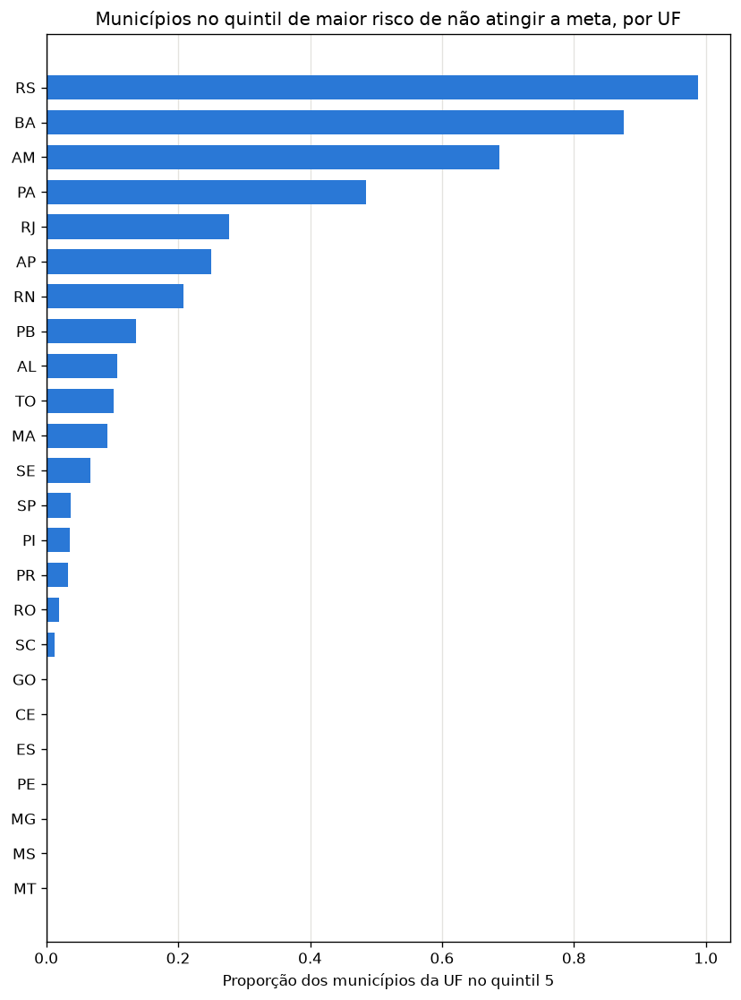

# Ranking de risco dos municípios

Fragmento do README, a consolidar na unidade de documentação. Gerado por `python -m src.modeling.ranking_municipios` (cerca de 4 minutos) a partir da configuração dos modelos em `models/`.

## Como é feito

O risco de cada município vem de um modelo que **não o viu**. A tabela é dividida em 5 dobras por município (`GroupKFold`), e cada dobra é prevista por uma cópia do modelo ajustada nas outras quatro. O algoritmo e os hiperparâmetros são os escolhidos pelo treino; só o ajuste é refeito. Usar o modelo final daria um risco otimista aos 80% de municípios em que ele foi treinado.

As previsões fora da dobra têm AUC-ROC de **0,777 em T2** e **0,628 em T1**, iguais às da validação cruzada do treino. No ranking de meta, a proporção real de municípios que não atingiram a meta cresce com o quintil de risco:

| Quintil de risco | 1 (menor) | 2 | 3 | 4 | 5 (maior) |
|---|---|---|---|---|---|
| Não atingiram a meta de fato | 13,4% | 32,2% | 46,7% | 58,8% | **82,9%** |

## Dois rankings, duas perguntas

**Risco de não atingir a meta não é o mesmo que risco educacional.** O topo do ranking de meta são municípios com alfabetização alta e meta alta: Dom Macedo Costa (BA) alfabetizava 85,9% em 2023 e tinha meta de 80% para 2024. A correlação entre os dois rankings abaixo é até negativa (−0,21). Por isso o projeto entrega os dois, e cada um responde a uma pergunta.

### 1. Risco de não atingir a meta (T2): `ranking_risco_meta_municipios.csv`

Responde: **"como prever municípios que podem não atingir metas futuras?"**

5.226 municípios da rede municipal, do maior para o menor risco, com a probabilidade de não atingir a meta, a posição geral e na UF, o quintil e, para contexto, a taxa de 2023, a meta de 2024, o resultado real e as taxas de não alfabetizados real e esperada.

- **O risco é concentrado por estado:** 98,8% dos municípios do Rio Grande do Sul e 87,6% dos da Bahia estão no quintil de maior risco; nenhum do Ceará, de Minas Gerais, de Pernambuco, de Goiás, do Espírito Santo, de Mato Grosso ou de Mato Grosso do Sul está.
- Isso repete o efeito de estado de [readme-treino-t2.md](readme-treino-t2.md): o ranking usa o desempenho dos outros municípios do estado em 2024. Para um ano futuro, em que esse desempenho ainda não é conhecido, a ordem **dentro de cada UF** (`posicao_na_uf`) é mais confiável que a ordem geral.

### 2. Abaixo do perfil (T1): `ranking_abaixo_do_perfil_municipios.csv`

Responde: **"quais municípios apresentam maior risco educacional?"**

Para cada município, a taxa de não alfabetizados **esperada** pelo perfil (UF, região, IDHM, rede e caderno, prevista fora da dobra pelo modelo de T1) é comparada com a **real**. O excesso (real menos esperada) aponta os municípios que estão pior do que o perfil prevê: o problema ali não se explica pelo território, e é onde uma investigação local tem mais a encontrar. Só entram os 5.134 municípios com pelo menos 50 alunos, porque a taxa de poucos alunos é ruidosa (a mediana é de 122).

Os dez maiores excessos:

| Município | UF | Alunos | Não alfabetizados (real) | Esperado pelo perfil | Excesso |
|---|---|---|---|---|---|
| Filadélfia | TO | 138 | 87,7% | 49,6% | +38,1 p.p. |
| Morro Cabeça no Tempo | PI | 106 | 79,2% | 41,7% | +37,6 p.p. |
| Cuité de Mamanguape | PB | 95 | 81,1% | 44,5% | +36,6 p.p. |
| Santa Rosa do Purus | AC | 58 | 84,5% | 49,0% | +35,5 p.p. |
| São José do Bonfim | PB | 58 | 79,3% | 44,3% | +35,0 p.p. |
| Barra do Ouro | TO | 148 | 85,8% | 51,2% | +34,6 p.p. |
| Porto de Pedras | AL | 268 | 71,3% | 37,3% | +34,0 p.p. |
| Lagoa do Tocantins | TO | 114 | 82,5% | 49,3% | +33,1 p.p. |
| Francisco Dumont | MG | 70 | 67,1% | 35,5% | +31,7 p.p. |
| Babaçulândia | TO | 166 | 80,7% | 49,3% | +31,4 p.p. |

O outro extremo do arquivo também interessa: municípios **muito melhores** do que o perfil prevê, como Coruripe (AL, 1.597 alunos, 50 p.p. abaixo do esperado), são candidatos a boas práticas a estudar.

## Limitações

- O ranking de meta herda o efeito de estado e vale para 2024; não foi validado em outro ano, porque só há um ano com rótulo.
- O perfil de T1 só conhece atributos do território. O excesso mede o que o território não explica, não a causa: pode ser gestão, contexto local não medido ou ruído de uma turma pequena.
- Um município com 50 a 100 alunos ainda tem taxa instável; o número de alunos está no arquivo para ser considerado.
- Associação, não causa: estar no topo de um ranking indica onde olhar primeiro, não o que fazer.
